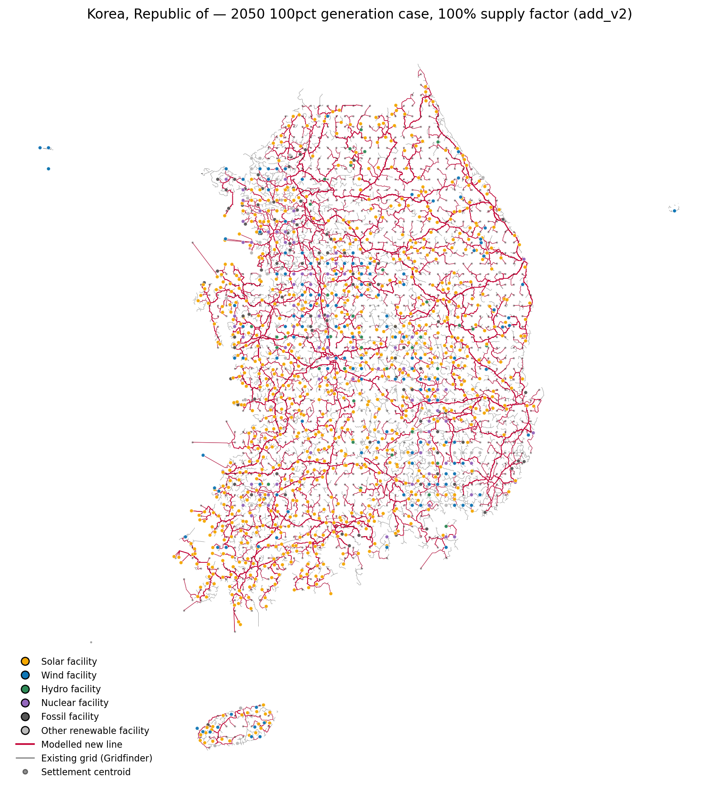

# A global geospatial dataset of renewable electricity supply and modelled supply paths for 2024, 2030 and 2050

This repository contains the code and selected supporting files for a global, spatially explicit workflow covering 189 country and territory units at 300 arc-second resolution (approximately 10 km at the equator).

The dataset's Zenodo concept DOI is [10.5281/zenodo.20362070](https://doi.org/10.5281/zenodo.20362070) and resolves to its latest version. The code archive concept DOI is [10.5281/zenodo.20362685](https://doi.org/10.5281/zenodo.20362685). The [GitHub repository](https://github.com/jjh6838/global-renewable-electricity-supply-networks) may include changes made after the archived code release.

The dataset includes a 2024 baseline and future scenarios for 2030 and 2050. Future scenarios comprise a 100% reference case and 80% and 60% sensitivity cases based on the projected annual generation inputs. The published runs use a 100% supply factor.



*Example map: Republic of Korea, 2050, 100pct generation case, 100% supply factor.*

Sample data for the Republic of Korea are available in the `sample_data` subfolder. Additional preview maps are available in the `sample_maps` subfolder.

## Dataset at a glance

| Item | Description |
|---|---|
| Geographic coverage | 189 country and territory units |
| Model years | 2024 baseline; 2030 and 2050 future scenarios |
| Future cases | 100% reference, 80% and 60% sensitivity cases |
| Number of model runs | 1,323 country-year-case runs |
| Spatial resolution | 300 arc-seconds (approximately 10 km at the equator) |
| Country-level outputs | Generation facilities, settlement-centroids, modelled supply paths, and national summary tables |
| Supporting outputs | Global solar, wind, and hydropower viability screening layers for 2030 and 2050 |
| Dataset archive (concept DOI; latest version) | [10.5281/zenodo.20362070](https://doi.org/10.5281/zenodo.20362070) |

## Repository structure

```text
.
├── .gitignore, CITATION.cff, LICENSE, README.md, environment.yml
├── config.py, countries_list.txt
├── p1_a_ember_gem_2024.py
├── p1_b_ember_2024_30_50.py
├── p1_c_prep_landcover.py
├── p1_d_viable_solar.py
├── p1_e_viable_wind.py
├── p1_f_utils_hydro.py
├── p1_f_viable_hydro.py
├── process_country_supply.py
├── process_country_siting.py
├── process_completion.py
├── combine_one_results.py
├── combine_global_results.py
├── generate_hpc_scripts.py
├── submit_all_parallel.sh, submit_all_parallel_siting.sh
├── submit_one_direct.sh, submit_one_direct_siting.sh, submit_workflow.sh
├── parallel_scripts/, parallel_scripts_siting/
├── data_country_class_wb/, data_country_pop_density_wb/
├── data_energy_ember/, data_energy_projections_iea/
├── data_facilities_gem/, data_pop_un/
├── bigdata_*/                       # Large locally staged geospatial inputs
├── figure_scripts/
├── sample_data/, sample_maps/
├── outputs_arcgis/, outputs_global/, outputs_per_country/, outputs_processed_data/
└── zenodo_package_v1_0_0/, zenodo_package_v1_0_1/
```

Large `bigdata_*` inputs and generated `outputs_*` are not required to inspect the code, but are needed for corresponding full workflow runs. The Zenodo dataset archive is separate from the code repository.

## Workflow

The workflow has a shared preparation stage followed by country-level processing. The 2024 baseline uses steps B1–B4. Future scenarios use steps F1–F5.

### Shared preparation

Run these scripts once before processing countries:

| Script | Purpose |
|---|---|
| `p1_a_ember_gem_2024.py` | Prepare 2024 national generation inputs and facility records. |
| `p1_b_ember_2024_30_50.py` | Prepare national generation inputs for the 2030 and 2050 cases. |
| `p1_c_prep_landcover.py` | Prepare the common land-cover grid. |
| `p1_d_viable_solar.py`, `p1_e_viable_wind.py`, `p1_f_viable_hydro.py` | Prepare renewable generation viability screening layers for future siting. |

### Country-level processing

| Step | Description | Main script |
|---|---|---|
| B1 | Derive the 2024 national generation envelope from annual generation statistics, harmonised to six technology types. | `p1_a_ember_gem_2024.py` |
| B2 | Distribute the national generation envelope across populated settlement-centroids using spatial weights. | `process_country_supply.py` |
| B3 | Map generation facilities and estimate their annual generation for use in supply allocation. | `process_country_supply.py` |
| B4 | Build modelled facility-to-settlement supply paths and allocate available supply to settlement-centroids. | `process_country_supply.py` |
| F1 | Estimate 2030 and 2050 national generation envelopes using the 2024 baseline, NDC renewable-electricity targets, IEA WEO scenarios, and population projections. Construct the 100%, 80%, and 60% generation cases. | `p1_b_ember_2024_30_50.py` |
| F2 | Distribute each future generation envelope across populated settlement-centroids and prepare projected population values. | `process_country_supply.py` |
| F3 | Update the future facility stock using planned facilities and expected retirements. | `process_country_supply.py` |
| F4 | Estimate and site additional modelled generation facilities, using renewable viability layers for solar, wind, and hydropower. | `process_country_siting.py` |
| F5 | Update supply paths and allocate available supply from the combined mapped and modelled facility stock. | `process_country_supply.py` |

The future workflow runs an intermediate supply allocation before siting and a final allocation after siting. The final 2030 and 2050 outputs use the `_add_v2` suffix. The 2024 baseline has no siting stage and no `_add_v2` suffix.

## Input datasets

Small supporting files are included in this repository. Large geospatial inputs are not included and must be obtained from their cited sources and placed in the corresponding local folders.

| Dataset | Purpose | Local folder | Source |
|---|---|---|---|
| GHS-POP settlement population grid | Spatial allocation of national generation envelopes | `bigdata_settlements_jrc` | JRC |
| Population projections | Country-level population projections for 2030 and 2050 | `data_pop_un` | United Nations |
| Country classification | Regional and income-group benchmarks | `data_country_class_wb` | World Bank |
| Administrative boundaries | Country clipping and attribution | `bigdata_gadm` | GADM |
| Maritime boundaries | Offshore screening support | `bigdata_eez` | Flanders Marine Institute |
| Baseline electricity-generation statistics | National annual generation by technology | `data_energy_ember` | Ember Energy and contributing sources |
| Future electricity-generation scenarios | Inputs for 2030 and 2050 projections | `data_energy_projections_iea` | IEA |
| NDC renewable-electricity commitments | Renewable-generation inputs for future scenarios | `data_energy_ember` | Ember Energy |
| Generation facility records | Facility locations, technology, status, and capacity | `data_facilities_gem` | GEM |
| Electricity network data | Baseline network routing | `bigdata_gridfinder` | GridFinder |
| Land cover | Renewable-siting viability screening | `bigdata_landcover_cds` | Copernicus Climate Data Store |
| Existing solar and wind sites | Supporting reference data for renewable screening | `bigdata_solar_wind_ms` | Microsoft Global Renewables Watch |
| Solar resource data | Baseline solar resource | `bigdata_solar_pvout` | World Bank Global Solar Atlas |
| Wind resource data | Baseline wind resource | `bigdata_wind_era5` | Copernicus Climate Data Store |
| Runoff data | Baseline hydrological conditions | `bigdata_hydro_era5_land` | Copernicus Climate Data Store |
| River network and attributes | Hydropower screening | `bigdata_hydro_atlas` | HydroATLAS |
| Future solar resource projections | Future solar screening | `bigdata_solar_cmip6` | CMIP6 via Copernicus Climate Data Store |
| Future wind resource projections | Future wind screening | `bigdata_wind_cmip6` | CMIP6 via Copernicus Climate Data Store |
| Future runoff projections | Future hydropower screening | `bigdata_hydro_cmip6` | CMIP6 via Copernicus Climate Data Store |

See the manuscript and its Supplementary Information for full dataset references and access details. The workflow expects input paths and filenames to follow those used by the scripts; update the relevant loaders if your local layout differs.

## Running the workflow

### Environment

The Conda environment is defined in [environment.yml](environment.yml) and requires Python 3.12 or later:

```bash
conda env create -f environment.yml
conda activate p1_etl
```

Stage the required input datasets before running the scripts. For climate projections that require downloads, configure access to the Copernicus Climate Data Store as needed.

### Prepare shared inputs

```bash
python p1_a_ember_gem_2024.py
python p1_b_ember_2024_30_50.py
python p1_c_prep_landcover.py
python p1_d_viable_solar.py
python p1_e_viable_wind.py
python p1_f_viable_hydro.py
```

### Process one country

For the 2024 baseline, run the supply workflow:

```bash
ANALYSIS_YEAR=2024 python process_country_supply.py KOR --scenario 100pct
```

For 2030 or 2050, run supply, siting, and final supply in sequence. Wait for each step to finish before starting the next:

```bash
ANALYSIS_YEAR=2030 python process_country_supply.py KOR --scenario 80pct
ANALYSIS_YEAR=2030 python process_country_siting.py KOR --scenario 80pct
ANALYSIS_YEAR=2030 python process_country_supply.py KOR --scenario 80pct
```

The examples use Bash syntax for setting `ANALYSIS_YEAR`. In PowerShell, set the variable with `$env:ANALYSIS_YEAR = "2030"` before running the commands. Use `--help` on a script for its available options.

To combine country outputs into a global GeoPackage, use:

```bash
python combine_global_results.py --scenario 2030_supply_100%_80pct_add_v2
```

The repository also includes SLURM launchers for parallel country processing. Cluster paths and resource settings may need to be adapted; see [generate_hpc_scripts.py](generate_hpc_scripts.py) and the `submit_*.sh` scripts.

### Adapting the workflow

Set the model year with `ANALYSIS_YEAR`, select a future generation case with `--scenario 100pct`, `--scenario 80pct`, or `--scenario 60pct`, and use `--supply-factor` when testing a different fraction of facility generation. The generation case and supply factor are separate settings; the archived runs use a 100% supply factor. Update shared spatial and siting settings in [config.py](config.py). Run `python <script>.py --help` for script-specific options, and keep the same year, generation case, and supply factor across each future supply–siting–supply sequence.

The published configuration uses 100 m node snapping, a 30 km grid-component stitching limit, and a 50 km facility/settlement-to-grid attachment limit. A separate 300 km straight-line search finds candidate facility–settlement pairs before shortest-path routing. Renewable siting uses a separate 300 km search radius. These parameters govern different operations and can affect which connections, candidate sites, and allocation coverage result; they are configurable in `config.py` for reruns.

## Data records

The complete dataset is available from the [Zenodo archive](https://doi.org/10.5281/zenodo.20362070), which resolves to the latest version. To access the dataset, download the files from the Zenodo record and extract the archive. Select a country and run from its scenario folder using the ISO3 code in the file name. The included `file_manifest.csv` lists archived files, and `checksum_sha256.txt` can be used to verify file integrity.

The archive is organized as follows:

```text
dataset/
├── 2024_supply_100%_100pct/
├── 2030_supply_100%_100pct_add_v2/
├── 2030_supply_100%_80pct_add_v2/
├── 2030_supply_100%_60pct_add_v2/
├── 2050_supply_100%_100pct_add_v2/
├── 2050_supply_100%_80pct_add_v2/
├── 2050_supply_100%_60pct_add_v2/
├── global_renewable_viability_layers/
├── README.md
├── file_manifest.csv
├── checksum_sha256.txt
├── folder_file_description.csv
└── data_dictionary.md
```

Country-year runs are represented by three Parquet spatial layer types and an Excel summary workbook; a spatial file may be absent when that layer has no features to write. The global screening folder contains solar, wind, and hydropower layers for 2030 and 2050 in Parquet and GeoTIFF formats.

| Output | Example file | Contents |
|---|---|---|
| Generation facilities | `facilities_KOR_add_v2.parquet` | Mapped and modelled facilities, technology, capacity, and estimated annual generation. |
| Settlement-centroids | `centroids_KOR_add_v2.parquet` | Settlement population, assigned generation envelope, allocated supply, and allocation status. |
| Supply paths | `polylines_KOR_add_v2.parquet` | Modelled facility-to-settlement paths, path length, and allocated annual supply. |
| National summary | `2050_supply_100%_100pct_KOR_add_v2.xlsx` | Country- and year-level generation, supply, and allocation statistics. |

### Key fields

Field names below follow the archived Parquet layers. `{year}` is replaced by the model year (2030 or 2050).

**Generation facility layers** — Point vector, Parquet

| Field | Description | Unit |
|---|---|---|
| `geometry` | Facility location | Point |
| `GID_0` | ISO3 country code | Code |
| `GEM unit/phase ID` | Source GEM identifier for a GEM-mapped facility; workflow-created facilities in future years have numeric cluster IDs stored as text | ID |
| `Grouped_Type` | Harmonised generation technology | Category |
| `Latitude`, `Longitude` | Facility coordinates | Decimal degrees |
| `Adjusted_Capacity_MW` | Facility-capacity attribute | MW |
| `total_mwh` | Annual generation assigned to each facility by distributing the national technology-level MWh total in proportion to adjusted facility MW | MWh |
| `available_total_mwh` | Annual supply available for allocation after workflow parameters are applied | MWh |
| `supplied_mwh` | Annual supply allocated from the facility | MWh |
| `remaining_mwh` | Facility supply left unallocated | MWh |

Assigned MWh are allocation inputs and are not physically constrained by the recorded MW; do not use them to infer plant capacity factors.

In future-year layers, `Adjusted_Capacity_MW` retains the facility-capacity attribute while `total_mwh` is assigned from the scenario generation envelope for allocation; the MWh value is not rescaled to make it physically consistent with the retained MW. To distinguish mapped from workflow-created records, filter `GEM unit/phase ID` for identifiers consisting only of digits, then use `Grouped_Type` to identify their technology. Some workflow-created nuclear, fossil, and other-renewable records are allocation features rather than site-specific facility proposals.

**Settlement-centroid layers** — Point vector, Parquet

| Field | Description | Unit |
|---|---|---|
| `geometry` | Settlement-centroid location | Point |
| `GID_0` | ISO3 country code | Code |
| `centroid_idx` | Unique settlement-centroid identifier | ID |
| `Population_centroid` | Baseline population in the grid cell | Persons |
| `Population_{year}_centroid` | Population in the model year | Persons |
| `Generation_Envelope_{year}_centroid` | National generation envelope assigned to the centroid | MWh |
| `supplying_facility_distance` | Distance(s) to linked facility or facilities | km |
| `supplying_facility_type` | Technology type(s) of linked facility or facilities | Category |
| `supplying_facility_gem_id` | Identifier(s) of linked facility or facilities | ID |
| `supply_received_mwh` | Annual supply allocated to the centroid | MWh |
| `supply_status` | Allocation status of the centroid | Category |

The `supplying_facility_*` fields may contain comma-separated values when multiple facilities are linked.

**Supply-path layers** — Polyline vector, Parquet

| Field | Description | Unit |
|---|---|---|
| `geometry` | Modelled facility-to-settlement path | Line |
| `GID_0` | ISO3 country code | Code |
| `connection_id` | Settlement-centroid–facility connection identifier | ID |
| `centroid_idx` | Linked settlement-centroid identifier | ID |
| `facility_gem_id` | Linked facility identifier | ID |
| `facility_type` | Technology of linked facility | Category |
| `distance_km` | Length of the modelled supply path | km |
| `supply_mwh` | Annual supply allocated along the path | MWh |
| `active_supply` | Whether the path carries allocated supply | Yes/No |

Each supply-path record describes a modelled facility-to-settlement connection, not an individual physical grid segment. `active_supply` indicates allocated supply, not operational electrical activation; all archived supply-path records have this field set to Yes.

The linked facility identifier is included in `connection_id`, so paths can also be distinguished by whether their supplying facility is GEM-mapped or workflow-created. A path may traverse multiple input network segments and include links added by the workflow; segment-level provenance is not retained. Paths do not provide voltage, line ratings, or other engineering attributes, and shared segments mean that summed path lengths are not unique physical network length.

**National summary tables** — Excel `.xlsx`

| Summary item | Description | Unit |
|---|---|---|
| Country and model year | Country name, ISO3 code, and year | Text, code, year |
| Configuration parameters | Key workflow settings, including supply factor | Text or numeric |
| National generation envelope | Annual generation input summed across technologies | MWh |
| `Original_Facility_Capacity_MWh` | Legacy label for the sum of facility-level `total_mwh` values before applying `SUPPLY_FACTOR`; it is annual energy, not facility capacity | MWh |
| `Generation_Types`, `Generation_Envelope_MWh_{technology}` | Technology categories and their contributions to the national generation envelope | Category, MWh |
| Available supply | Annual facility generation available for allocation | MWh |
| Supplied electricity | Annual supply allocated to settlement-centroids | MWh |
| Unsupplied electricity | Facility supply left unallocated | MWh |
| Allocation coverage | Allocated supply as a share of the generation envelope | Percent |
| Technology breakdown | Generation, available supply, and allocation by technology | MWh |
| Settlement status counts | Number of settlement-centroids by allocation status | Count |

### Global viability screening fields

The global screening records support future siting and are provided by technology and year in Parquet and GeoTIFF formats.

**Solar and wind layers** — Point vector, Parquet

| Field | Description | Unit / format |
|---|---|---|
| `geometry` | Cell-centre location on the common grid | Point |
| `source` | Technology label | `solar` or `wind` |
| `value_{year}` | Projected resource value for the model year | Solar: kWh/kWp/day; wind: W/m² |
| `value_baseline` | Baseline resource value | Same as `value_{year}` |
| `delta` | Future-to-baseline relative change factor | Ratio |
| `uncertainty` | Inter-model range | Same as `value_{year}` |
| `is_ms_viable` | Cell contains an existing solar or wind reference site | Boolean |
| `is_lc_valid` | Cell passes land-cover screening | Boolean |
| `meets_threshold` | Cell meets the technology resource threshold | Boolean |
| `is_viable` | Final screening result | Boolean |

**Hydropower layers** — Point vector at river-reach centroids, Parquet

| Field | Description | Unit / format |
|---|---|---|
| `geometry` | River-reach centroid location | Point |
| `HYRIV_ID` | RiverATLAS reach identifier | ID |
| `dis_m3_pyr`, `dis_m3_pmn`, `dis_m3_pmx` | Baseline mean annual, minimum monthly, and maximum monthly discharge | m³/s |
| `delta` | Future-to-baseline relative runoff change factor | Ratio |
| `dis_m3_pyr_projected` | Projected mean annual discharge | m³/s |
| `flow_reliability` | Minimum monthly divided by mean annual discharge | Ratio |
| `ORD_STRA` | Strahler stream order | Integer |
| `sgr_dk_rav_raw` | Native RiverATLAS river gradient | dm/km |
| `sgr_dk_rav` | River gradient used in screening | m/km |
| `ele_mt_cav` | Mean local catchment elevation | m |
| `UPLAND_SKM` | Upstream catchment area | km² |
| `landcover_class` | Land-cover class used for screening | Class code |

Hydropower screening applies a gradient threshold of 1.5 m/km (15 dm/km in the native HydroATLAS units); raw dm/km values are converted to m/km before screening. The 20 m mean local catchment-elevation criterion is a broad topographic screening proxy, not hydraulic head.

The matching GeoTIFF layers store projected resource values on the common grid. File names follow `{TECH}_VIABLE_CENTROIDS_{YEAR}.parquet` and `.tif`, where `TECH` is `SOLAR`, `WIND`, or `HYDRO`, and `YEAR` is 2030 or 2050. The archive's `data_dictionary.md` and `folder_file_description.csv` provide accompanying field notes and file descriptions.

### Folder and file names

Future scenario folders identify the year, supply factor, generation case, and processing stage. For example:

```text
2050_supply_100%_100pct_add_v2/
```

Here, `2050` is the model year, `100%` is the supply factor, `100pct` is the generation case, and `_add_v2` identifies the final post-siting allocation. Folders without `_add_v2` contain intermediate outputs. The published dataset uses a 100% supply factor. The generation case (100%, 80%, or 60%) is distinct from the supply factor.

## Interpretation

- The generation envelope is a scenario input distributed across settlement-centroids; it is not a direct estimate of electricity demand or consumption.
- Allocated supply and unallocated portions are outputs of the modelled allocation workflow, not observations of dispatch, electricity demand, shortages, or lost load. Allocation is not constrained by line capacity, congestion, or voltage.
- Supply paths are screening-level allocation connections, not engineered transmission designs or evidence of operational grid connections. They do not quantify transmission-expansion requirements.
- Renewable viability layers and modelled facility locations are broad screening outputs, not confirmed or permitted project sites; some workflow-created records are allocation features rather than site-specific proposals.
- The outputs use annual generation accounting and do not assess hourly or seasonal adequacy, operational resilience, or transmission sizing under peak or coincident conditions.

## Citation and license

- **Dataset:** Jeong, J., Thomas, F. & Hall, J. W. *A global geospatial dataset of renewable electricity supply and network infrastructure for 2024, 2030 and 2050*. [Zenodo concept DOI (latest version)](https://doi.org/10.5281/zenodo.20362070).
- **Code:** cite the archived code version used for your analysis. The code archive concept DOI is [10.5281/zenodo.20362685](https://doi.org/10.5281/zenodo.20362685).
- **License:** MIT; see [LICENSE](LICENSE).
